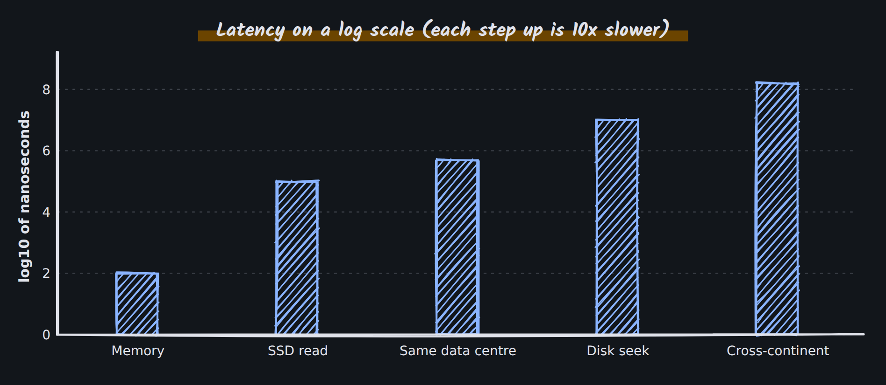

# Estimation cheat sheet

From [Back-of-the-Envelope Estimation](https://shardhappens.dev/guides/estimation/), which has the method, a worked example and the common mistakes.

## Cheat sheet: time

| Period | Exact seconds | Use |
|---|---|---|
| Day | 86,400 | 10^5 (understates the rate by about 15%, which is within rounding error) |
| Month | about 2.6 million | 2.5 x 10^6 |
| Year | about 31.5 million | 3 x 10^7 |

The most useful conversion:

| Per day | Per second (divide by 86,400) |
|---|---|
| 1 million | about 12 |
| 10 million | about 120 |
| 100 million | about 1,200 |
| 1 billion | about 12,000 |

## Cheat sheet: sizes

Units grow by a factor of about 1,000 at each step.

| Unit | Bytes | Roughly holds |
|---|---|---|
| Kilobyte (KB) | 10^3 | A short text message or a small database row |
| Megabyte (MB) | 10^6 | A compressed photo |
| Gigabyte (GB) | 10^9 | About three hours of video at low quality |
| Terabyte (TB) | 10^12 | Fits on a single disk |
| Petabyte (PB) | 10^15 | Needs several disks |

These are typical item sizes. Treat them as starting assumptions, and adjust if the interviewer gives better ones.

| Item | Size | Why |
|---|---|---|
| Integer / timestamp | 4 to 8 bytes | Fixed-width number types |
| Unique id (UUID) | 16 bytes | 128 bits |
| Character of English text | 1 byte | In UTF-8. Other scripts use 2 to 4 |
| Short post or message | about 200 bytes | A sentence or two |
| Database row with metadata | about 500 bytes to 1 KB | Several fields, plus index overhead |
| Web page (HTML only) | about 100 KB | |
| Photo, compressed | about 200 KB resized, 1 to 3 MB original | |
| Video | about 5 MB per minute at low quality | Varies widely with resolution |

A caution on bits and bytes: network speeds are quoted in bits per second, storage in bytes. One byte is 8 bits, so 1 gigabyte per second is 8 gigabits per second.

## Cheat sheet: how long things take

These are approximate values, useful for comparing options rather than as exact figures.

| Operation | Time | Compared with a memory read |
|---|---|---|
| Read from main memory | about 100 nanoseconds | 1x |
| Read from a solid-state disk | about 100 microseconds | 1,000x |
| Round trip inside a data centre | about 0.5 milliseconds | 5,000x |
| Read from a spinning disk (seek) | about 10 milliseconds | 100,000x |
| Round trip between continents | about 150 milliseconds (80 for a short ocean crossing) | 1,500,000x |

Memory is a thousand or more times faster than disk or network, which is why caches work. A cross-continent call costs more than everything else combined, which is why data is placed near users.

## The formulas

| To get | Calculate | Notes |
|---|---|---|
| Average requests per second | daily users x actions per user per day / 86,400 | Do it separately for reads and writes |
| Peak requests per second | average x peak factor | Use 2 to 3 for normal daily cycles, 10 or more for events. See [Guide 3](https://shardhappens.dev/guides/load/) |
| Storage per year | new items per day x size per item x 365 | |
| Total storage | storage per year x years kept x copies | Three copies is the usual replication assumption |
| Outgoing bandwidth | read requests per second x response size | Convert to bits (x 8) when comparing with network links |
| Cache memory | distinct items read per day x share worth caching x size per item | A common starting share is 20% |
| Number of servers | peak requests per second / requests one server can handle | Add spare capacity. See Guide 3 |

**Why 20% for the cache?** In most systems a small share of items receives most of the traffic (the "80/20" pattern: roughly 20% of items get 80% of requests). Caching that share captures most of the benefit. It is a starting assumption, not a law.

**Why three copies?** One copy can be lost with a disk. Two leaves no protection while a failed one is being replaced. Three is the common default in distributed storage.

[All problems](README.md)
