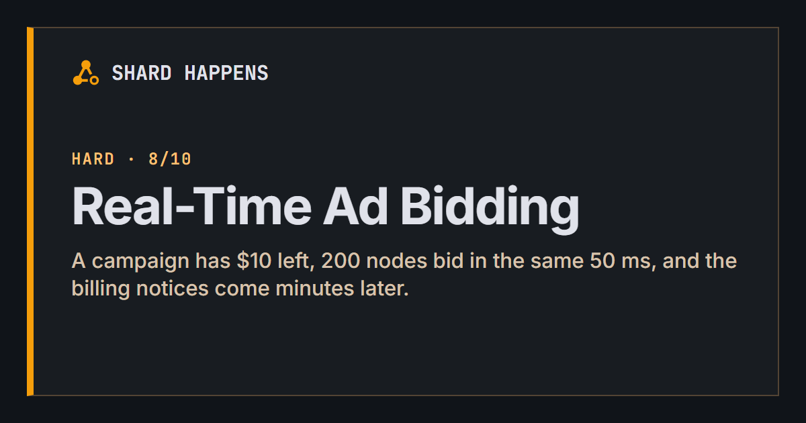

# 61. Real-Time Ad Bidding

> A campaign has $10 left, 200 nodes bid in the same 50 ms, and the billing notices come minutes later.

The Bidder Challenge (demand-side platforms bidding over OpenRTB). Answer each bid request inside the exchange's deadline at a million requests a second, and spend each campaign's daily budget smoothly and keep any overspend within a stated bound, when a win is only known from a notice that can arrive minutes later or never.

| Level | Score | Data modelling | Scale | Consistency | Real-time | Algorithmic depth |
|---|---|---|---|---|---|---|
| Hard | 8/10 | 3/5 | 5/5 | 4/5 | 4/5 | 3/5 |

The introduction, the difficulty breakdown, the problem framing and the questions are open to everyone. The rest of the page needs premium access.

**[Read it on shardhappens.dev](https://shardhappens.dev/problems/ad-bidding/)**

[All problems](../README.md)
