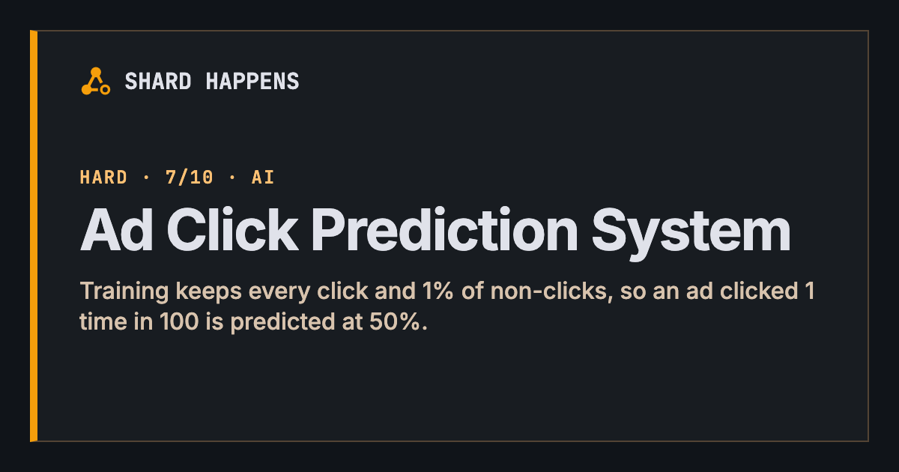

# 75. Ad Click Prediction System

> Training keeps every click and 1% of non-clicks, so an ad clicked 1 time in 100 is predicted at 50%.

The Probability Contract Challenge (click prediction for ads, as in Facebook's ads ranking). A model trained on every click and 1% of non-clicks must hand the auction a number it can multiply by a bid: the sampling correction, evaluation on unsampled data, and calibration while traffic changes.

| Level | Score | Data modelling | Scale | Consistency | Real-time | Algorithmic depth |
|---|---|---|---|---|---|---|
| Hard · AI | 7/10 | 3/5 | 4/5 | 2/5 | 4/5 | 4/5 |

The introduction, the difficulty breakdown, the problem framing and the questions are open to everyone. The rest of the page needs premium access.

**[Read it on shardhappens.dev](https://shardhappens.dev/problems/ad-click-prediction/)**

[All problems](../README.md)
