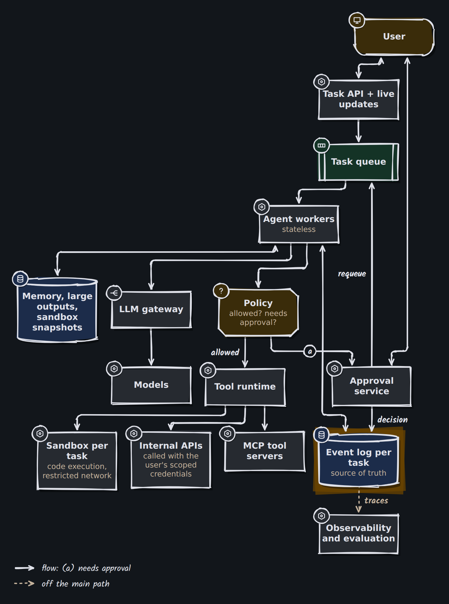

# 15. AI Agent Platform

> The agent issued a refund, the worker crashed before recording it, and on resume the agent issued it again.

The Autonomy Challenge (coding agents, support agents that issue refunds, operations assistants). AI architecture: a model that plans and takes actions over many steps. Tests durable execution, safety boundaries and control of a component that is not deterministic.

| Level | Score | Data modelling | Scale | Consistency | Real-time | Algorithmic depth |
|---|---|---|---|---|---|---|
| Hard · AI | 8/10 | 3/5 | 3/5 | 4/5 | 3/5 | 4/5 |

## What the interviewer looks for

| Green flags | Red flags |
|---|---|
| Asks whether a fixed workflow would do | Uses an agent for everything |
| Persists every step and resumes from the log | Task state in worker memory or only in a live sandbox |
| Idempotency for tool calls | Retries tools blindly after a crash |
| Enforces permissions and approvals outside the model | "We tell the model not to do that in the prompt" |
| Sandboxes code and scopes credentials | Agent runs with a service account that can do anything |
| Sets step, token and time budgets | No stop condition other than the model saying it is done |
| Plans for evaluation and tracing | No way to tell whether a change made the agent better or worse |

The page is free to read in full: the questions an interviewer asks, the approaches compared, the whole design and the numbers behind it.

**[Read it on shardhappens.dev](https://shardhappens.dev/problems/ai-agent-platform/)**

[All problems](../README.md)
