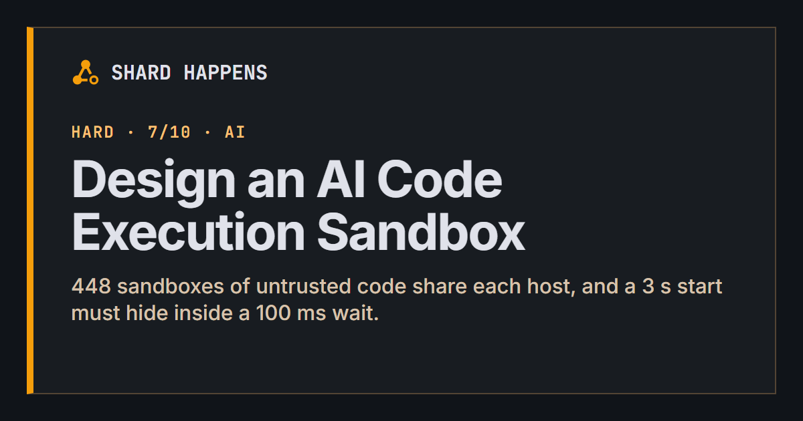

# 35. Design an AI Code Execution Sandbox

> 448 sandboxes of untrusted code share each host, and a 3 s start must hide inside a 100 ms wait.

The Isolation Challenge (the code interpreter tool in a chat assistant or agent). AI architecture: code a language model wrote runs on shared hosts next to other tenants' code. Tests the isolation boundary, start-up time and the cost of keeping sandboxes ready.

| Level | Score | Data modelling | Scale | Consistency | Real-time | Algorithmic depth |
|---|---|---|---|---|---|---|
| Hard · AI | 7/10 | 2/5 | 3/5 | 2/5 | 4/5 | 3/5 |

The introduction, the difficulty breakdown, the problem framing and the questions are open to everyone. The rest of the page needs premium access.

**[Read it on shardhappens.dev](https://shardhappens.dev/problems/ai-code-sandbox/)**

[All problems](../README.md)
