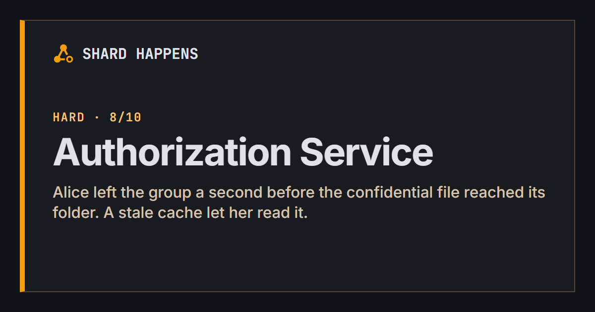

# 41. Authorization Service

> Alice left the group a second before the confidential file reached its folder. A stale cache let her read it.

The New Enemy Challenge (Google Zanzibar, SpiceDB, OpenFGA). A permission check answers in milliseconds from replicated, cached relationship data and must still never say yes after a revoke it should have seen.

| Level | Score | Data modelling | Scale | Consistency | Real-time | Algorithmic depth |
|---|---|---|---|---|---|---|
| Hard | 8/10 | 4/5 | 4/5 | 5/5 | 3/5 | 3/5 |

The introduction, the difficulty breakdown, the problem framing and the questions are open to everyone. The rest of the page needs premium access.

**[Read it on shardhappens.dev](https://shardhappens.dev/problems/authorization-service/)**

[All problems](../README.md)
