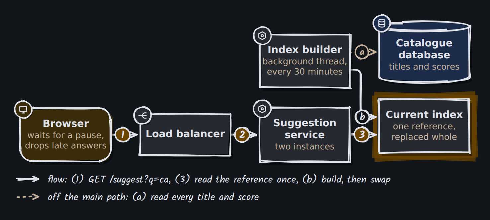

# 32. Autocomplete Box

> Two typed letters can match 180,000 word starts among a million titles, and scanning them takes 18 ms for ten suggestions.

The Prefix Challenge (the search box on a shop, a library catalogue or a help centre). An easy problem in one process: what the typed text is compared with, a sorted index of word starts with the best ten stored for busy prefixes, a rebuilt index swapped in whole, and the browser's rules for late answers.

| Level | Score | Data modelling | Scale | Consistency | Real-time | Algorithmic depth |
|---|---|---|---|---|---|---|
| Easy | 3/10 | 2/5 | 1/5 | 1/5 | 2/5 | 3/5 |

## What the interviewer looks for

| Green flags | Red flags |
|---|---|
| Asks whether text matches the title's start or any word, and counts the keys each needs | Matches only the title's start without asking, so "iphone" misses "Apple iPhone 15 Case" |
| Estimates how many keys a two-letter prefix matches before choosing a structure | Collects every match and sorts it on each keystroke |
| Computes the structure's memory, including two copies while a build runs | Says "a trie" with no node count or memory figure |
| Builds a new index and replaces one reference | Edits the live index in place, or holds a lock across the rebuild |
| Runs one normalisation function on titles and typed text | Lower-cases one side only, or forgets accents |
| Waits for a pause and drops answers for an older prefix | Shows whichever answer arrives last |
| Says a scan is fine at 100,000 titles and prices it at a million | Adds a search cluster or shards without estimating the load and memory first |

The page is free to read in full: the questions an interviewer asks, the approaches compared, the whole design and the numbers behind it.

**[Read it on shardhappens.dev](https://shardhappens.dev/problems/autocomplete-box/)**

[All problems](../README.md)
