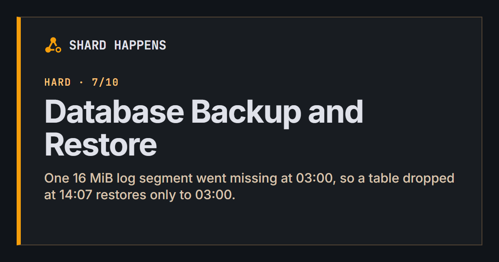

# 66. Database Backup and Restore

> One 16 MiB log segment went missing at 03:00, so a table dropped at 14:07 restores only to 03:00.

The Restore Challenge (Amazon RDS point-in-time restore, pgBackRest, WAL-G). Backing up a fleet of PostgreSQL databases so any of them can be brought back to any second of the last 14 days: base backups and the WAL archive, full against incremental, finding a gap in the chain, retention that never breaks a chain, restore tests and backups out of reach of whoever can delete the database.

| Level | Score | Data modelling | Scale | Consistency | Real-time | Algorithmic depth |
|---|---|---|---|---|---|---|
| Hard | 7/10 | 2/5 | 3/5 | 4/5 | 2/5 | 3/5 |

The introduction, the difficulty breakdown, the problem framing and the questions are open to everyone. The rest of the page needs premium access.

**[Read it on shardhappens.dev](https://shardhappens.dev/problems/backup-restore/)**

[All problems](../README.md)
