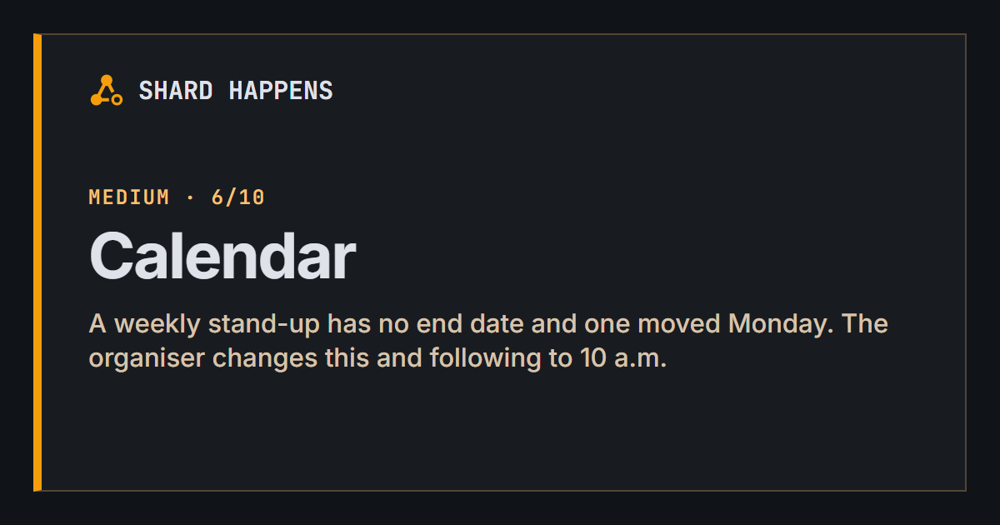

# 45. Calendar

> A weekly stand-up has no end date and one moved Monday. The organiser changes this and following to 10 a.m.

The Recurrence Challenge (Google Calendar, Outlook calendar). Recurring events with no end date, single occurrences moved or cancelled, edits to this event, this and following or all events, attendees in other time zones, and free/busy across several people.

| Level | Score | Data modelling | Scale | Consistency | Real-time | Algorithmic depth |
|---|---|---|---|---|---|---|
| Medium | 6/10 | 4/5 | 3/5 | 3/5 | 2/5 | 3/5 |

The introduction, the difficulty breakdown, the problem framing and the questions are open to everyone. The rest of the page needs premium access.

**[Read it on shardhappens.dev](https://shardhappens.dev/problems/calendar/)**

[All problems](../README.md)
