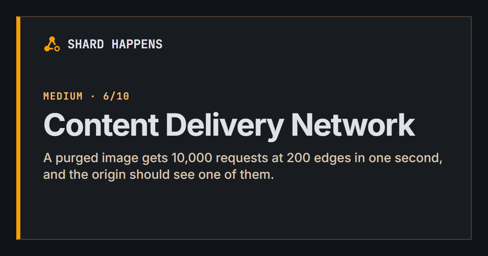

# 50. Content Delivery Network

> A purged image gets 10,000 requests at 200 edges in one second, and the origin should see one of them.

The Origin Offload Challenge (Cloudflare, Amazon CloudFront, Akamai, Fastly). Serving cacheable HTTP objects from 200 edge locations so the origin sees a small, bounded share of requests: routing to an edge, the cache key and HTTP freshness, parents and collapsed misses, purges, and an origin or an edge that fails.

| Level | Score | Data modelling | Scale | Consistency | Real-time | Algorithmic depth |
|---|---|---|---|---|---|---|
| Medium | 6/10 | 1/5 | 4/5 | 3/5 | 2/5 | 2/5 |

The introduction, the difficulty breakdown, the problem framing and the questions are open to everyone. The rest of the page needs premium access.

**[Read it on shardhappens.dev](https://shardhappens.dev/problems/cdn/)**

[All problems](../README.md)
