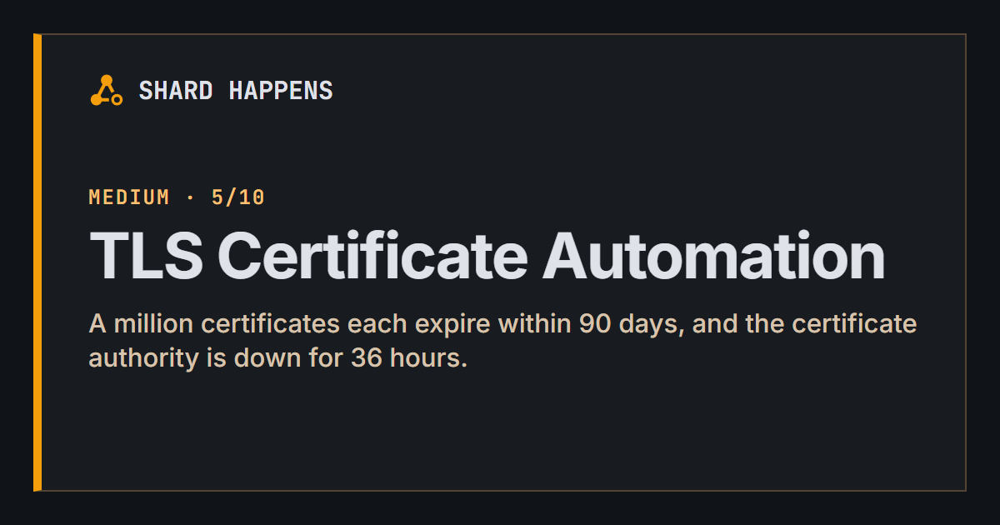

# 68. TLS Certificate Automation

> A million certificates each expire within 90 days, and the certificate authority is down for 36 hours.

The Expiry Challenge (custom-domain HTTPS on a hosting platform, Let's Encrypt, cert-manager). Prove control of a million customer hostnames, obtain a certificate for each, renew every one well before it expires and install it on every edge server, while the certificate authority is slow, rate-limits the platform or is down for a day.

| Level | Score | Data modelling | Scale | Consistency | Real-time | Algorithmic depth |
|---|---|---|---|---|---|---|
| Medium | 5/10 | 2/5 | 3/5 | 3/5 | 2/5 | 2/5 |

The introduction, the difficulty breakdown, the problem framing and the questions are open to everyone. The rest of the page needs premium access.

**[Read it on shardhappens.dev](https://shardhappens.dev/problems/certificate-automation/)**

[All problems](../README.md)
