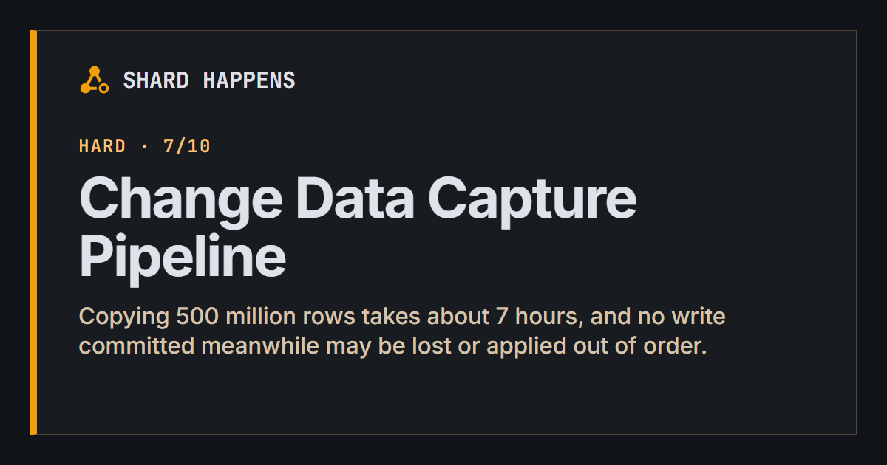

# 43. Change Data Capture Pipeline

> Copying 500 million rows takes about 7 hours, and no write committed meanwhile may be lost or applied out of order.

The Handover Challenge (Debezium, PostgreSQL logical replication). Turning a database's log into an ordered change stream for a search index, a cache and a warehouse, starting from a table that already holds data.

| Level | Score | Data modelling | Scale | Consistency | Real-time | Algorithmic depth |
|---|---|---|---|---|---|---|
| Hard | 7/10 | 2/5 | 3/5 | 5/5 | 3/5 | 3/5 |

The introduction, the difficulty breakdown, the problem framing and the questions are open to everyone. The rest of the page needs premium access.

**[Read it on shardhappens.dev](https://shardhappens.dev/problems/change-data-capture/)**

[All problems](../README.md)
