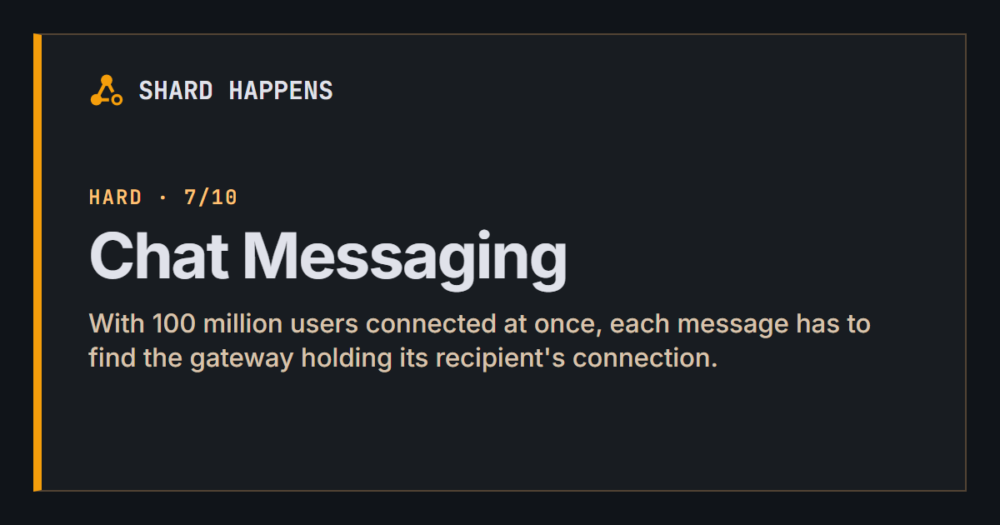

# 7. Chat Messaging

> With 100 million users connected at once, each message has to find the gateway holding its recipient's connection.

The Stateful Connection Challenge (WhatsApp, Slack, Messenger). Added to the set: tests long-lived connections, message ordering and delivery guarantees across unreliable mobile networks.

| Level | Score | Data modelling | Scale | Consistency | Real-time | Algorithmic depth |
|---|---|---|---|---|---|---|
| Hard | 7/10 | 3/5 | 4/5 | 4/5 | 5/5 | 3/5 |

The introduction, the difficulty breakdown, the problem framing and the questions are open to everyone. The rest of the page needs premium access.

**[Read it on shardhappens.dev](https://shardhappens.dev/problems/chat-messaging/)**

[All problems](../README.md)
