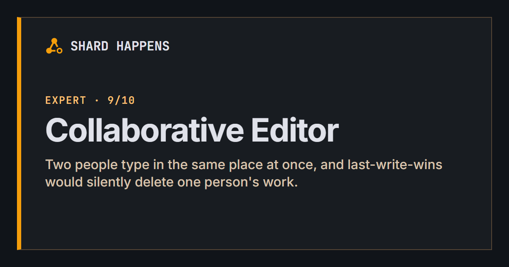

# 8. Collaborative Editor

> Two people type in the same place at once, and last-write-wins would silently delete one person's work.

The Convergence Challenge (Google Docs, Figma, Notion). Added to the set as the stretch problem: concurrent edits must converge to the same document on every client without locking anyone out.

| Level | Score | Data modelling | Scale | Consistency | Real-time | Algorithmic depth |
|---|---|---|---|---|---|---|
| Expert | 9/10 | 4/5 | 3/5 | 5/5 | 5/5 | 5/5 |

The introduction, the difficulty breakdown, the problem framing and the questions are open to everyone. The rest of the page needs premium access.

**[Read it on shardhappens.dev](https://shardhappens.dev/problems/collaborative-editor/)**

[All problems](../README.md)
