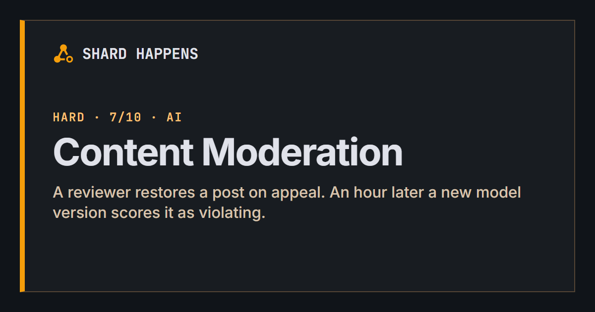

# 46. Content Moderation

> A reviewer restores a post on appeal. An hour later a new model version scores it as violating.

The Second Opinion Challenge (moderation on YouTube, Facebook and Instagram). AI architecture: a classifier that is wrong some of the time decides about 200 million posts a day, reviewers can look at 180,000, and enforcement must follow the latest valid decision when model scores, reviews, appeals and policy changes arrive out of order.

| Level | Score | Data modelling | Scale | Consistency | Real-time | Algorithmic depth |
|---|---|---|---|---|---|---|
| Hard · AI | 7/10 | 3/5 | 3/5 | 4/5 | 2/5 | 3/5 |

The introduction, the difficulty breakdown, the problem framing and the questions are open to everyone. The rest of the page needs premium access.

**[Read it on shardhappens.dev](https://shardhappens.dev/problems/content-moderation/)**

[All problems](../README.md)
