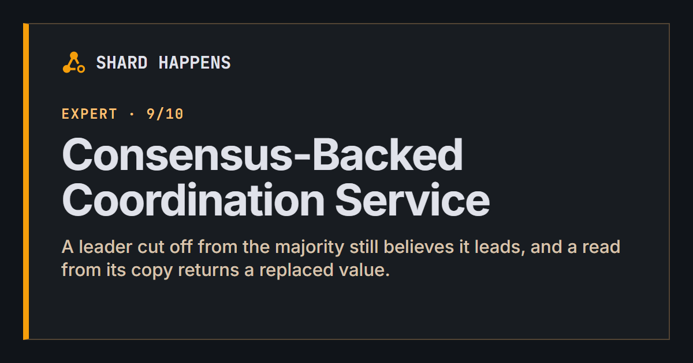

# 28. Consensus-Backed Coordination Service

> A leader cut off from the majority still believes it leads, and a read from its copy returns a replaced value.

The Contract Challenge (etcd, ZooKeeper). A small linearizable store for leader election, locks and configuration, and what it still promises when its own leader is cut off, a write times out or history has been compacted.

| Level | Score | Data modelling | Scale | Consistency | Real-time | Algorithmic depth |
|---|---|---|---|---|---|---|
| Expert | 9/10 | 3/5 | 2/5 | 5/5 | 3/5 | 5/5 |

The introduction, the difficulty breakdown, the problem framing and the questions are open to everyone. The rest of the page needs premium access.

**[Read it on shardhappens.dev](https://shardhappens.dev/problems/coordination-service/)**

[All problems](../README.md)
