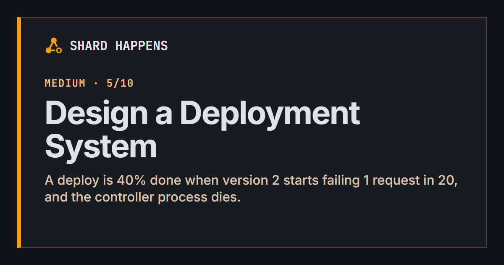

# 73. Design a Deployment System

> A deploy is 40% done when version 2 starts failing 1 request in 20, and the controller process dies.

The Rollout Challenge (Kubernetes Deployments, Argo Rollouts, Spinnaker). Rolling 200 instances of a stateless service from version 1 to version 2 by reconciling desired state against observed state: surge and unavailability limits, readiness, automatic rollback on an error-rate signal, draining, canary and blue-green, and what happens when the controller dies part way.

| Level | Score | Data modelling | Scale | Consistency | Real-time | Algorithmic depth |
|---|---|---|---|---|---|---|
| Medium | 5/10 | 2/5 | 2/5 | 3/5 | 3/5 | 2/5 |

The introduction, the difficulty breakdown, the problem framing and the questions are open to everyone. The rest of the page needs premium access.

**[Read it on shardhappens.dev](https://shardhappens.dev/problems/deployment-controller/)**

[All problems](../README.md)
