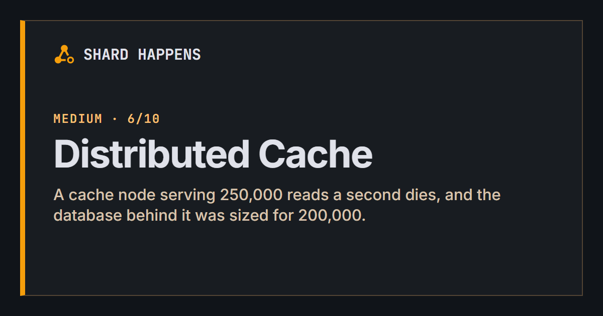

# 25. Distributed Cache

> A cache node serving 250,000 reads a second dies, and the database behind it was sized for 200,000.

The Thundering Herd Challenge (Memcached, Redis Cluster, Netflix EVCache). An in-memory cache cluster in front of a database: consistent hashing, two copies of every key, node failures and additions, hot keys and stampedes, and keeping each of them under the database's capacity.

| Level | Score | Data modelling | Scale | Consistency | Real-time | Algorithmic depth |
|---|---|---|---|---|---|---|
| Medium | 6/10 | 1/5 | 4/5 | 3/5 | 2/5 | 3/5 |

The introduction, the difficulty breakdown, the problem framing and the questions are open to everyone. The rest of the page needs premium access.

**[Read it on shardhappens.dev](https://shardhappens.dev/problems/distributed-cache/)**

[All problems](../README.md)
