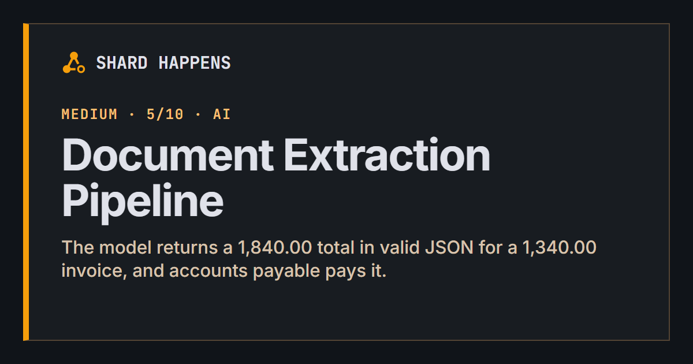

# 57. Document Extraction Pipeline

> The model returns a 1,840.00 total in valid JSON for a 1,340.00 invoice, and accounts payable pays it.

The Silent Error Challenge (invoice processing in accounts payable products, document services such as Amazon Textract's AnalyzeExpense). AI architecture: a model fills a typed record from each invoice, is wrong some of the time without saying so, and the payment system acts on the numbers.

| Level | Score | Data modelling | Scale | Consistency | Real-time | Algorithmic depth |
|---|---|---|---|---|---|---|
| Medium · AI | 5/10 | 4/5 | 2/5 | 3/5 | 1/5 | 3/5 |

The introduction, the difficulty breakdown, the problem framing and the questions are open to everyone. The rest of the page needs premium access.

**[Read it on shardhappens.dev](https://shardhappens.dev/problems/document-extraction/)**

[All problems](../README.md)
