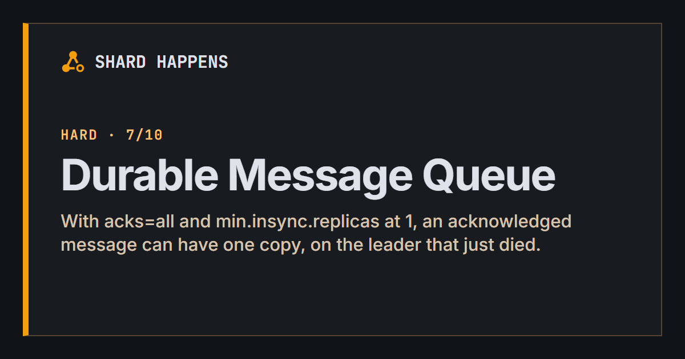

# 18. Durable Message Queue

> With acks=all and min.insync.replicas at 1, an acknowledged message can have one copy, on the leader that just died.

The Durability Challenge (Apache Kafka, Amazon Kinesis Data Streams). A partitioned, replicated log, and the exact point at which an acknowledged message is safe.

| Level | Score | Data modelling | Scale | Consistency | Real-time | Algorithmic depth |
|---|---|---|---|---|---|---|
| Hard | 7/10 | 2/5 | 4/5 | 5/5 | 3/5 | 3/5 |

The introduction, the difficulty breakdown, the problem framing and the questions are open to everyone. The rest of the page needs premium access.

**[Read it on shardhappens.dev](https://shardhappens.dev/problems/durable-message-queue/)**

[All problems](../README.md)
