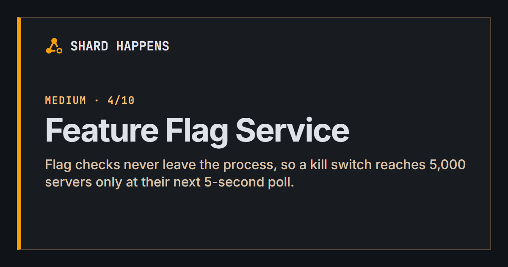

# 17. Feature Flag Service

> Flag checks never leave the process, so a kill switch reaches 5,000 servers only at their next 5-second poll.

The Propagation Challenge (LaunchDarkly, Unleash). Flag checks sit on every request, so they cannot wait on the flag service, and a kill switch still has to reach every server within seconds.

| Level | Score | Data modelling | Scale | Consistency | Real-time | Algorithmic depth |
|---|---|---|---|---|---|---|
| Medium | 4/10 | 2/5 | 2/5 | 3/5 | 2/5 | 2/5 |

The introduction, the difficulty breakdown, the problem framing and the questions are open to everyone. The rest of the page needs premium access.

**[Read it on shardhappens.dev](https://shardhappens.dev/problems/feature-flag-service/)**

[All problems](../README.md)
