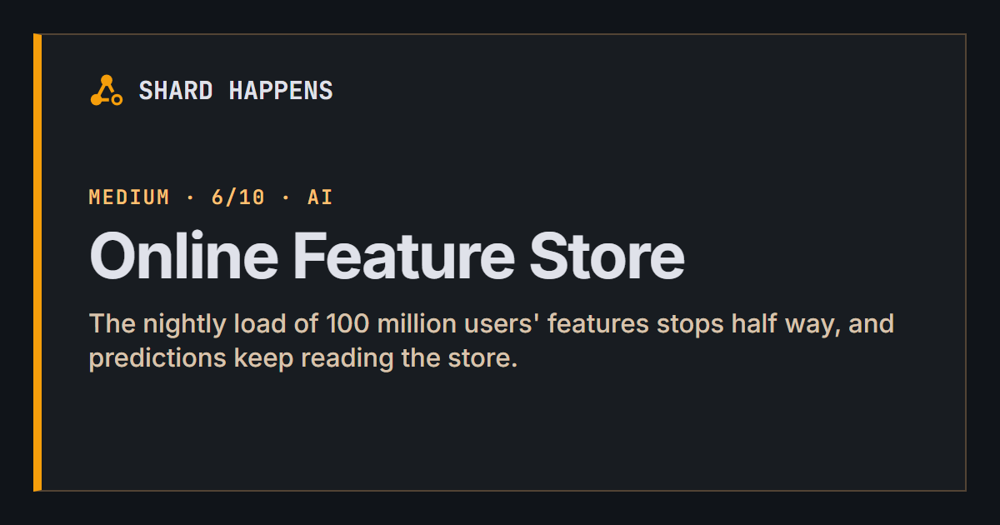

# 40. Online Feature Store

> The nightly load of 100 million users' features stops half way, and predictions keep reading the store.

The Training-Serving Skew Challenge (Feast, Uber's Michelangelo). An online feature store for model predictions: batch and stream values reaching a key-value store, half-written loads, freshness per feature, and serving the values a model was trained on.

| Level | Score | Data modelling | Scale | Consistency | Real-time | Algorithmic depth |
|---|---|---|---|---|---|---|
| Medium · AI | 6/10 | 3/5 | 3/5 | 3/5 | 3/5 | 2/5 |

The introduction, the difficulty breakdown, the problem framing and the questions are open to everyone. The rest of the page needs premium access.

**[Read it on shardhappens.dev](https://shardhappens.dev/problems/feature-store/)**

[All problems](../README.md)
