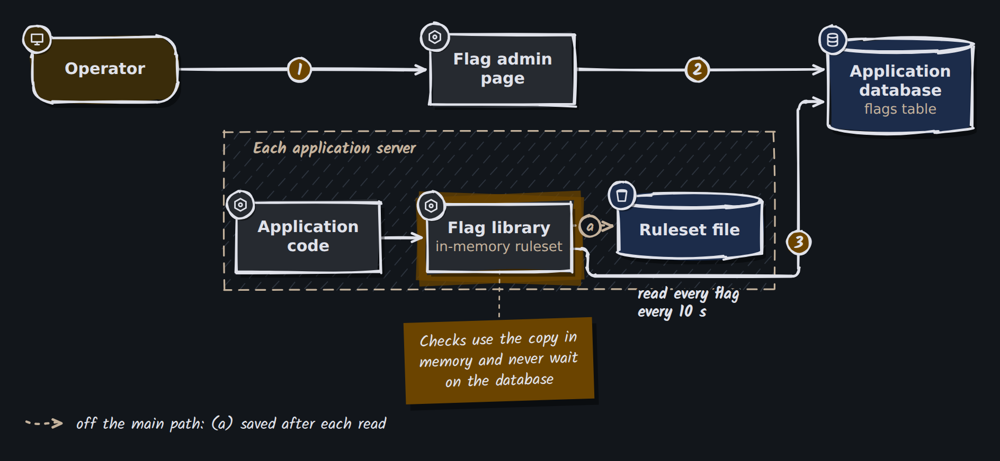

# 30. Feature Toggles for One Application

> For up to 12 seconds after a rollout grows, two servers can give one user different answers.

The Rollout Challenge (feature toggles kept in an application's own database). An easy problem: flags evaluated in memory on about 40 servers, a hash that keeps each user in the same group as a rollout grows, and a stated delay before every server holds a change.

| Level | Score | Data modelling | Scale | Consistency | Real-time | Algorithmic depth |
|---|---|---|---|---|---|---|
| Easy | 3/10 | 2/5 | 1/5 | 2/5 | 2/5 | 2/5 |

## What the interviewer looks for

| Green flags | Red flags |
|---|---|
| Answers every check from rules held in memory | Queries the database on every check |
| Buckets on a hash of the flag key and the user id, and shows why raising the percentage keeps everyone in | A random number per request, or a string hash that differs between processes |
| States the delay before every server has a change, with its arithmetic | "Changes apply instantly", and no delay or mechanism stated |
| Gives the value a check returns during an outage and on a server that starts without the database | A server that fails to start or to report ready while the database is unreachable |
| Reads the whole table and can say why reading by updated_at loses changes | Reads only rows with a newer updated_at than the last read |

The page is free to read in full: the questions an interviewer asks, the approaches compared, the whole design and the numbers behind it.

**[Read it on shardhappens.dev](https://shardhappens.dev/problems/feature-toggles/)**

[All problems](../README.md)
