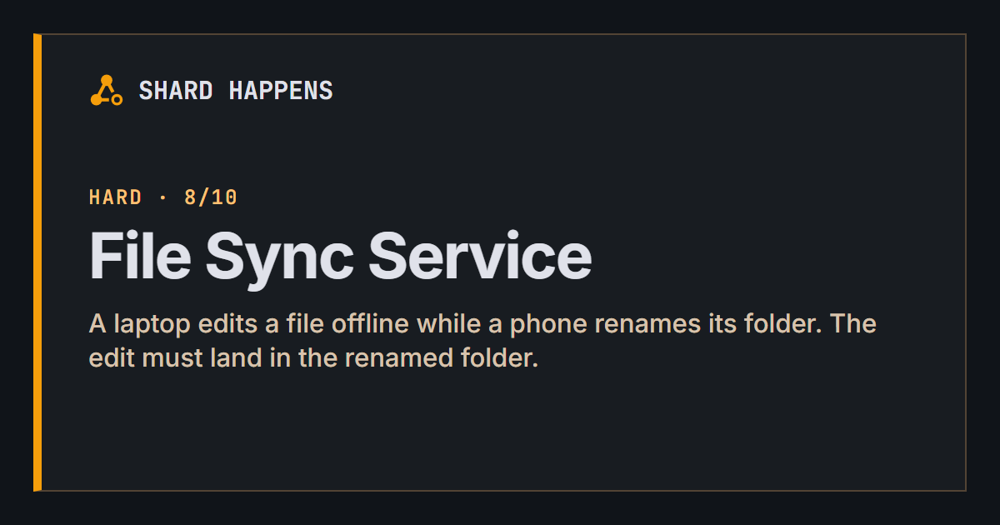

# 34. File Sync Service

> A laptop edits a file offline while a phone renames its folder. The edit must land in the renamed folder.

The Conflicted Copy Challenge (Dropbox, Google Drive, OneDrive). Keep one user's folder the same on every device, when changes arrive late, out of order and from devices that were offline for weeks, without losing an edit silently.

| Level | Score | Data modelling | Scale | Consistency | Real-time | Algorithmic depth |
|---|---|---|---|---|---|---|
| Hard | 8/10 | 4/5 | 4/5 | 5/5 | 3/5 | 3/5 |

The introduction, the difficulty breakdown, the problem framing and the questions are open to everyone. The rest of the page needs premium access.

**[Read it on shardhappens.dev](https://shardhappens.dev/problems/file-sync/)**

[All problems](../README.md)
