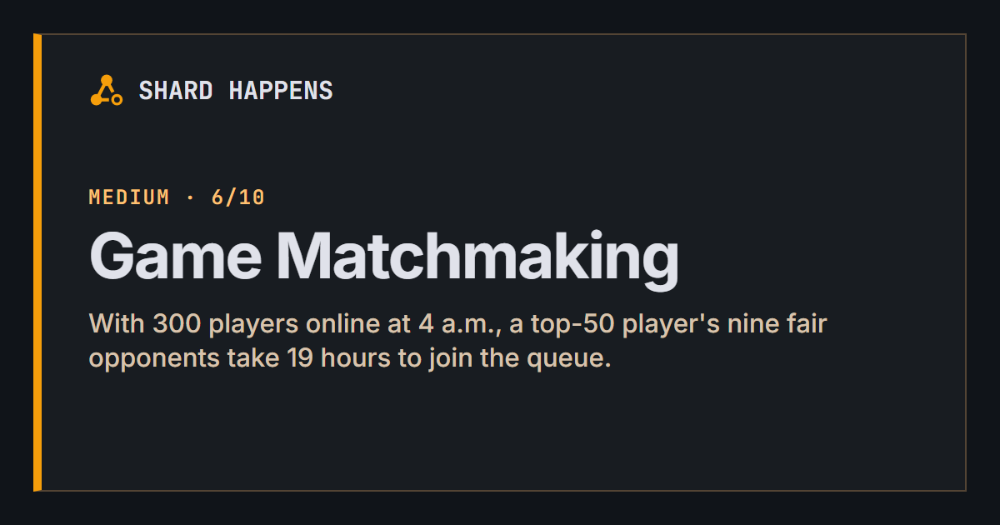

# 72. Game Matchmaking

> With 300 players online at 4 a.m., a top-50 player's nine fair opponents take 19 hours to join the queue.

The Fair Match Challenge (ranked queues, Open Match). Players join continuously, and the matchmaker forms teams of close skill in one region, keeps parties together, and relaxes its rules with waiting time up to a cap and a time limit.

| Level | Score | Data modelling | Scale | Consistency | Real-time | Algorithmic depth |
|---|---|---|---|---|---|---|
| Medium | 6/10 | 2/5 | 3/5 | 3/5 | 3/5 | 4/5 |

The introduction, the difficulty breakdown, the problem framing and the questions are open to everyone. The rest of the page needs premium access.

**[Read it on shardhappens.dev](https://shardhappens.dev/problems/game-matchmaking/)**

[All problems](../README.md)
