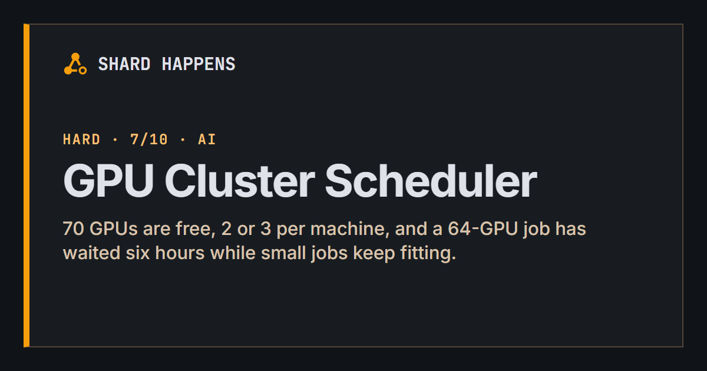

# 53. GPU Cluster Scheduler

> 70 GPUs are free, 2 or 3 per machine, and a 64-GPU job has waited six hours while small jobs keep fitting.

The Gang Scheduling Challenge (Slurm, Kubernetes with Kueue or Volcano). AI infrastructure: placing training jobs that need all their GPUs at once on a cluster shared by teams with quotas, without fragments, starved jobs or idle GPUs.

| Level | Score | Data modelling | Scale | Consistency | Real-time | Algorithmic depth |
|---|---|---|---|---|---|---|
| Hard · AI | 7/10 | 3/5 | 2/5 | 4/5 | 2/5 | 4/5 |

The introduction, the difficulty breakdown, the problem framing and the questions are open to everyone. The rest of the page needs premium access.

**[Read it on shardhappens.dev](https://shardhappens.dev/problems/gpu-scheduler/)**

[All problems](../README.md)
