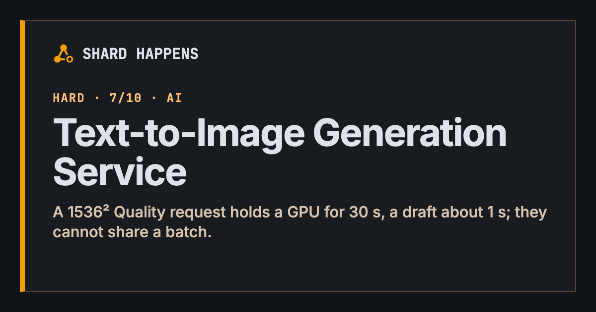

# 78. Text-to-Image Generation Service

> A 1536² Quality request holds a GPU for 30 s, a draft about 1 s; they cannot share a batch.

The Batch Compatibility Challenge (Midjourney, hosted image-generation APIs). AI infrastructure: serving one open diffusion model across a menu of image sizes and sampling settings, batching only jobs that can run together, and keeping expensive shapes from blocking cheap ones.

| Level | Score | Data modelling | Scale | Consistency | Real-time | Algorithmic depth |
|---|---|---|---|---|---|---|
| Hard · AI | 7/10 | 2/5 | 4/5 | 2/5 | 3/5 | 4/5 |

The introduction, the difficulty breakdown, the problem framing and the questions are open to everyone. The rest of the page needs premium access.

**[Read it on shardhappens.dev](https://shardhappens.dev/problems/image-generation/)**

[All problems](../README.md)
