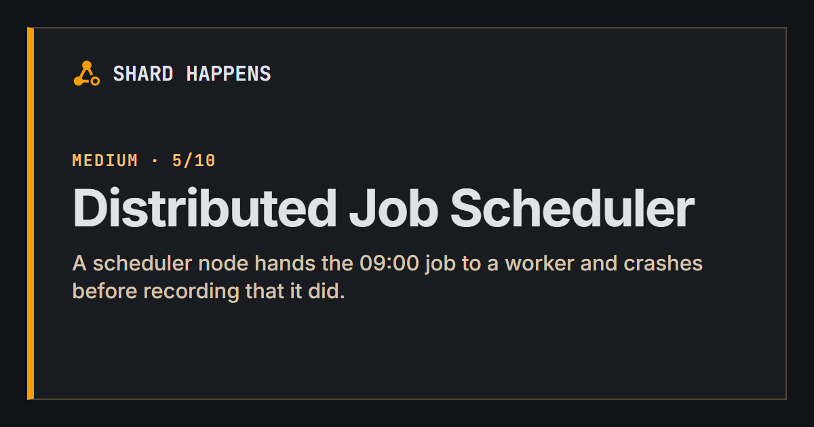

# 20. Distributed Job Scheduler

> A scheduler node hands the 09:00 job to a worker and crashes before recording that it did.

The Timing Challenge (cron across a fleet, Kubernetes CronJobs, Amazon EventBridge Scheduler). One-off and recurring jobs with retries, status and cancel, and what a scheduler crash between claiming a run and handing it on leaves behind.

| Level | Score | Data modelling | Scale | Consistency | Real-time | Algorithmic depth |
|---|---|---|---|---|---|---|
| Medium | 5/10 | 3/5 | 3/5 | 3/5 | 2/5 | 2/5 |

The introduction, the difficulty breakdown, the problem framing and the questions are open to everyone. The rest of the page needs a free account.

**[Read it on shardhappens.dev](https://shardhappens.dev/problems/job-scheduler/)**

[All problems](../README.md)
