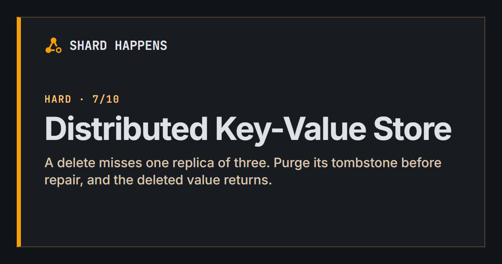

# 44. Distributed Key-Value Store

> A delete misses one replica of three. Purge its tombstone before repair, and the deleted value returns.

The Divergence Challenge (Amazon's Dynamo, Apache Cassandra). A replicated key-value store that keeps taking writes while replicas are unreachable: quorums and what R + W > N does and does not guarantee, hinted handoff and sloppy quorums, version vectors against last-write-wins, read repair, Merkle-tree anti-entropy and tombstones.

| Level | Score | Data modelling | Scale | Consistency | Real-time | Algorithmic depth |
|---|---|---|---|---|---|---|
| Hard | 7/10 | 2/5 | 3/5 | 5/5 | 2/5 | 4/5 |

The introduction, the difficulty breakdown, the problem framing and the questions are open to everyone. The rest of the page needs premium access.

**[Read it on shardhappens.dev](https://shardhappens.dev/problems/key-value-store/)**

[All problems](../README.md)
