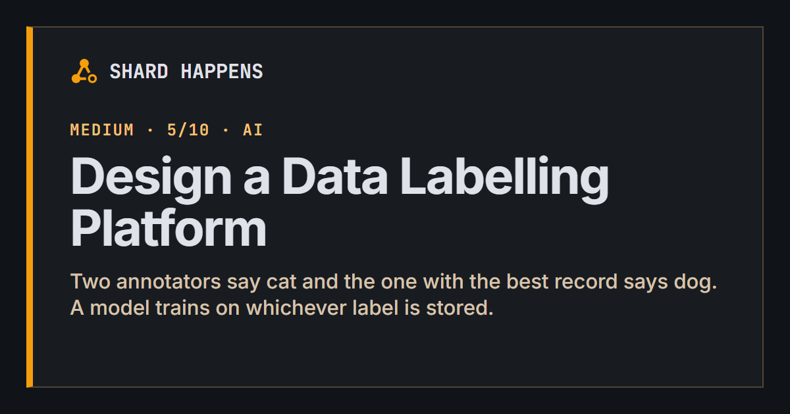

# 67. Design a Data Labelling Platform

> Two annotators say cat and the one with the best record says dog. A model trains on whichever label is stored.

The Disagreement Challenge (Label Studio, Amazon SageMaker Ground Truth). AI architecture: people label the examples a model is trained and judged on, and they disagree and make mistakes. Tests independent labels under leases, a stated rule for disagreement, measuring annotators with hidden examples, and dataset versions that never change.

| Level | Score | Data modelling | Scale | Consistency | Real-time | Algorithmic depth |
|---|---|---|---|---|---|---|
| Medium · AI | 5/10 | 4/5 | 2/5 | 3/5 | 1/5 | 3/5 |

The introduction, the difficulty breakdown, the problem framing and the questions are open to everyone. The rest of the page needs premium access.

**[Read it on shardhappens.dev](https://shardhappens.dev/problems/labelling-platform/)**

[All problems](../README.md)
