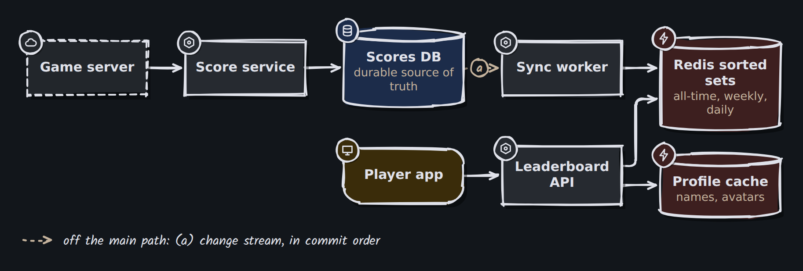

# 10. Leaderboard

> The top 10 is a cheap index query. A player's exact rank among 25 million means counting everyone ahead of them.

The Ranking Challenge (game leaderboards, fitness challenges, sales rankings). An easy problem with one key insight: "what is my rank?" is a different and harder query than "who is in the top 10?".

| Level | Score | Data modelling | Scale | Consistency | Real-time | Algorithmic depth |
|---|---|---|---|---|---|---|
| Easy | 3/10 | 2/5 | 2/5 | 2/5 | 3/5 | 2/5 |

## What the interviewer looks for

| Green flags | Red flags |
|---|---|
| Separates the top-N query from the rank query | Assumes an index on score solves both |
| Can explain why a sorted set finds rank quickly | "Use Redis" with no reason |
| Keeps a durable source of truth and a rebuild plan | Redis as the only copy of scores |
| Handles ties and time-boxed boards deliberately | Ignores ties, or recomputes daily boards from scratch |
| Checks that the data fits in memory before choosing | Proposes sharding before doing any arithmetic |

The page is free to read in full: the questions an interviewer asks, the approaches compared, the whole design and the numbers behind it.

**[Read it on shardhappens.dev](https://shardhappens.dev/problems/leaderboard/)**

[All problems](../README.md)
