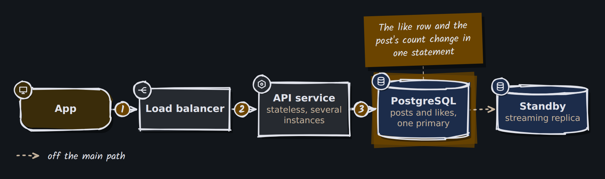

# 29. Like Button

> A like retried on a slow connection arrives twice. One row is stored and the count moves by one.

The Idempotency Challenge (likes and hearts on a forum, a blog or a small social app). An easy problem on one relational database: one like row per user and post, a count kept equal to the rows in the same statement, and what a retried tap does.

| Level | Score | Data modelling | Scale | Consistency | Real-time | Algorithmic depth |
|---|---|---|---|---|---|---|
| Easy | 2/10 | 2/5 | 1/5 | 2/5 | 1/5 | 1/5 |

## What the interviewer looks for

| Green flags | Red flags |
|---|---|
| Stores one row per user and post as the truth, with a key that makes a repeat harmless | Stores only a counter, with no record of who liked what |
| Makes the request name the wanted state, so a retry changes nothing | A toggle endpoint, or relying on the client never to retry |
| Changes the count only when the statement inserted or deleted a row, in the same transaction | Reads the count in the application and writes back the count plus one |
| Explains what happens when two identical requests overlap | "The database handles concurrency", with no mechanism |
| Reads the heart and the count in one query per screen | One query per post, or counting the rows on every render without pricing it |
| Puts a number on the hot-post limit and says where the design ends | Adds a cache, a queue or shards before doing the arithmetic |

The page is free to read in full: the questions an interviewer asks, the approaches compared, the whole design and the numbers behind it.

**[Read it on shardhappens.dev](https://shardhappens.dev/problems/like-button/)**

[All problems](../README.md)
