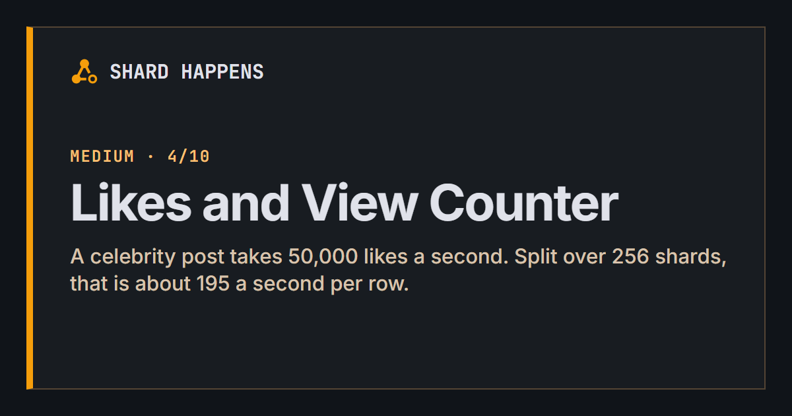

# 22. Likes and View Counter

> A celebrity post takes 50,000 likes a second. Split over 256 shards, that is about 195 a second per row.

The Counting Challenge (likes and view counts on Instagram, YouTube, X). Keeps the exact per-user like record apart from the counts readers see, and keeps one celebrity post from becoming a write hotspot.

| Level | Score | Data modelling | Scale | Consistency | Real-time | Algorithmic depth |
|---|---|---|---|---|---|---|
| Medium | 4/10 | 2/5 | 3/5 | 3/5 | 2/5 | 1/5 |

The introduction, the difficulty breakdown, the problem framing and the questions are open to everyone. The rest of the page needs premium access.

**[Read it on shardhappens.dev](https://shardhappens.dev/problems/likes-view-counter/)**

[All problems](../README.md)
