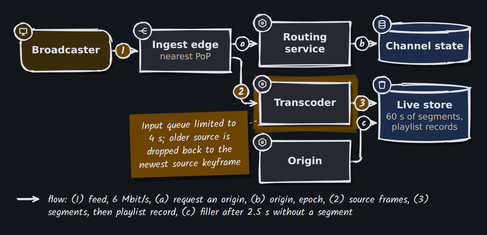

# 79. Live Broadcast Service

> The transcoder falls behind a feed that cannot pause, and gets back to live by discarding video at a keyframe.

The Live Edge Challenge (Twitch, YouTube Live). One broadcaster's feed is transcoded as it arrives and delivered to up to a million viewers, and when processing falls behind, the delay has to stay bounded and the video decodable.

| Level | Score | Data modelling | Scale | Consistency | Real-time | Algorithmic depth |
|---|---|---|---|---|---|---|
| Hard | 7/10 | 2/5 | 5/5 | 3/5 | 5/5 | 3/5 |

## What the interviewer looks for

| Green flags | Red flags |
|---|---|
| States a live-delay target and gives each stage it controls a bound | Fixes stalls by adding buffer, with no limit |
| Limits the transcoder's input queue in seconds and discards to a source keyframe | Queues every frame, so the delay grows for the rest of the broadcast |
| Starts every segment with an IDR frame and marks a skip with a discontinuity in every rendition | Drops frames between keyframes, or skips in one rendition only |
| Changes the playlist only by append and remove from the start, with segment numbers never reused | Rewrites the playlist, or reuses numbers or URLs after a failover |
| A pull-through tree with collapsing, playlists cached for about a second and segments for long | Pushes every channel to every edge, or caches playlists for minutes |
| Says lossless recovery needs a backup feed or retained source and costs the delay bound | Promises no lost video and near-live delay together |

The page is free to read in full: the questions an interviewer asks, the approaches compared, the whole design and the numbers behind it.

**[Read it on shardhappens.dev](https://shardhappens.dev/problems/live-broadcast/)**

[All problems](../README.md)
