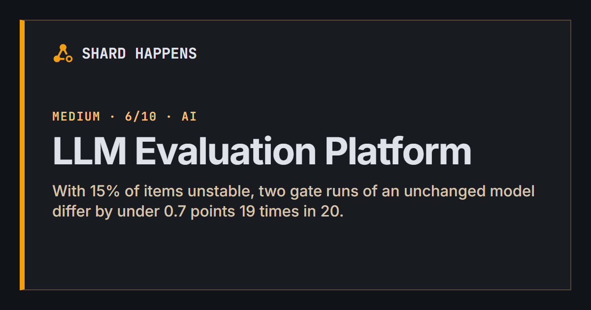

# 27. LLM Evaluation Platform

> With 15% of items unstable, two gate runs of an unchanged model differ by under 0.7 points 19 times in 20.

The Noisy Measurement Challenge (OpenAI Evals, EleutherAI's lm-evaluation-harness, Stanford's HELM). AI architecture: run evaluation suites against model and prompt versions, and tell a regression from the noise of a non-deterministic model graded by another one.

| Level | Score | Data modelling | Scale | Consistency | Real-time | Algorithmic depth |
|---|---|---|---|---|---|---|
| Medium · AI | 6/10 | 3/5 | 2/5 | 3/5 | 1/5 | 4/5 |

The introduction, the difficulty breakdown, the problem framing and the questions are open to everyone. The rest of the page needs premium access.

**[Read it on shardhappens.dev](https://shardhappens.dev/problems/llm-evaluation-platform/)**

[All problems](../README.md)
