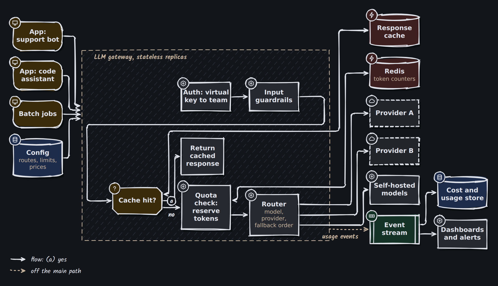

# 14. LLM Gateway

> 500 requests a second at peak, each streaming for about 20 seconds, keeps 10,000 connections open at once.

The Shared Resource Challenge (an internal platform that puts every team's model calls behind one API). AI architecture: classic gateway concerns (limits, failover, caching) meet workloads that are slow, streamed, priced per token and unpredictable in size.

| Level | Score | Data modelling | Scale | Consistency | Real-time | Algorithmic depth |
|---|---|---|---|---|---|---|
| Medium · AI | 6/10 | 2/5 | 3/5 | 3/5 | 4/5 | 3/5 |

## What the interviewer looks for

| Green flags | Red flags |
|---|---|
| Notices that the limit unit is tokens and the size is unknown upfront | Applies a request-per-second limiter unchanged |
| Sizes the system by concurrent streams | Sizes only by requests per second |
| Distinguishes failure before and during a stream | "Just retry on another provider" |
| Careful about when caching is safe | Semantic cache everywhere |
| Keeps provider keys central and attributes cost | Teams share one key |
| Keeps the gateway stateless with shared counters | In-memory limits per replica as the only mechanism |

The page is free to read in full: the questions an interviewer asks, the approaches compared, the whole design and the numbers behind it.

**[Read it on shardhappens.dev](https://shardhappens.dev/problems/llm-gateway/)**

[All problems](../README.md)
