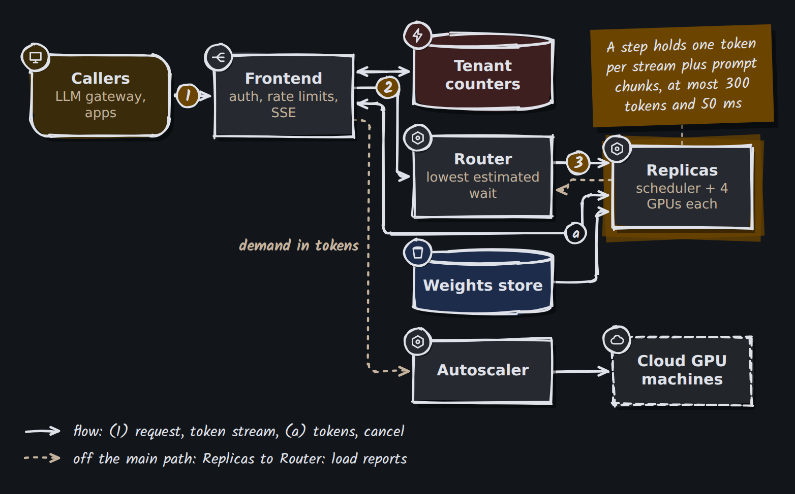

# 19. LLM Inference Serving

> A 30,000-token prompt prefilled in one step stops every other stream on its replica until it is done.

The Scarce Resource Challenge (hosted model APIs, a company running an open-weights model on its own GPUs). AI infrastructure: batching requests of very different lengths on GPUs that are expensive and take minutes to add, without wrecking time to first token.

| Level | Score | Data modelling | Scale | Consistency | Real-time | Algorithmic depth |
|---|---|---|---|---|---|---|
| Hard · AI | 7/10 | 2/5 | 4/5 | 2/5 | 5/5 | 4/5 |

## What the interviewer looks for

| Green flags | Red flags |
|---|---|
| Separates prefill from decode and says how each uses the GPU | Treats a request as a fixed unit of GPU time |
| Computes the cache per token and what fits beside the weights | Sizes by the weights alone, or reserves the maximum context for every request |
| Continuous batching with chunked prefill under a token budget | Static batches, or a long prompt prefilled in one step |
| Puts numbers on the trade between budget and gap between tokens | "Bigger batches are always better" |
| Bounded admission on estimated wait, 429 with Retry-After | An unbounded queue in front of the GPUs |
| Scales on demand in tokens, with headroom for the start time | Autoscales on GPU utilisation, or assumes replicas start in seconds |
| Fair ordering and rejection by guaranteed share | First come, first served across tenants |
| Cancels the request when the client disconnects | Keeps generating for a client that has gone |

The page is free to read in full: the questions an interviewer asks, the approaches compared, the whole design and the numbers behind it.

**[Read it on shardhappens.dev](https://shardhappens.dev/problems/llm-inference-serving/)**

[All problems](../README.md)
