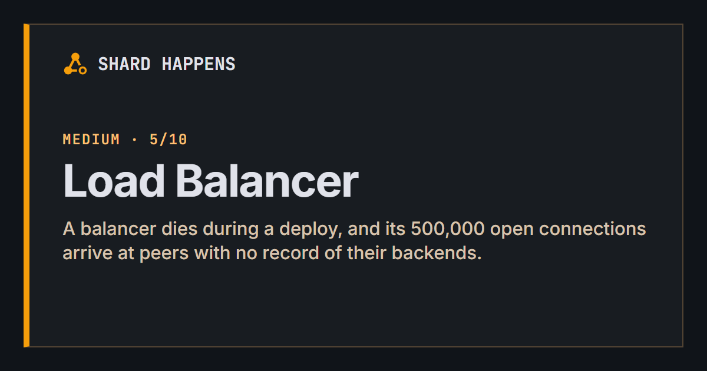

# 54. Load Balancer

> A balancer dies during a deploy, and its 500,000 open connections arrive at peers with no record of their backends.

The Flow Affinity Challenge (Google Maglev). A layer-4 load balancer of 4 machines in front of 100 backends: equal-cost multipath, consistent hashing into a lookup table, a connection table per balancer, draining, and which open connections break when a backend and a balancer change at once.

| Level | Score | Data modelling | Scale | Consistency | Real-time | Algorithmic depth |
|---|---|---|---|---|---|---|
| Medium | 5/10 | 1/5 | 3/5 | 3/5 | 3/5 | 3/5 |

The introduction, the difficulty breakdown, the problem framing and the questions are open to everyone. The rest of the page needs a free account.

**[Read it on shardhappens.dev](https://shardhappens.dev/problems/load-balancer/)**

[All problems](../README.md)
