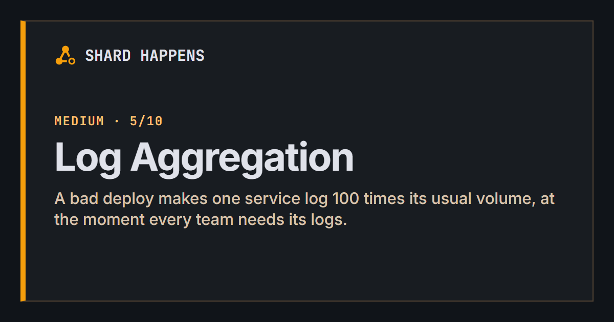

# 48. Log Aggregation

> A bad deploy makes one service log 100 times its usual volume, at the moment every team needs its logs.

The Incident Volume Challenge (the ELK stack, Datadog Logs, Grafana Loki). Tests whether the logging path stays out of the applications' way when an incident multiplies log volume, and what indexing every word costs against scanning compressed chunks.

| Level | Score | Data modelling | Scale | Consistency | Real-time | Algorithmic depth |
|---|---|---|---|---|---|---|
| Medium | 5/10 | 3/5 | 4/5 | 2/5 | 3/5 | 2/5 |

The introduction, the difficulty breakdown, the problem framing and the questions are open to everyone. The rest of the page needs premium access.

**[Read it on shardhappens.dev](https://shardhappens.dev/problems/log-aggregation/)**

[All problems](../README.md)
