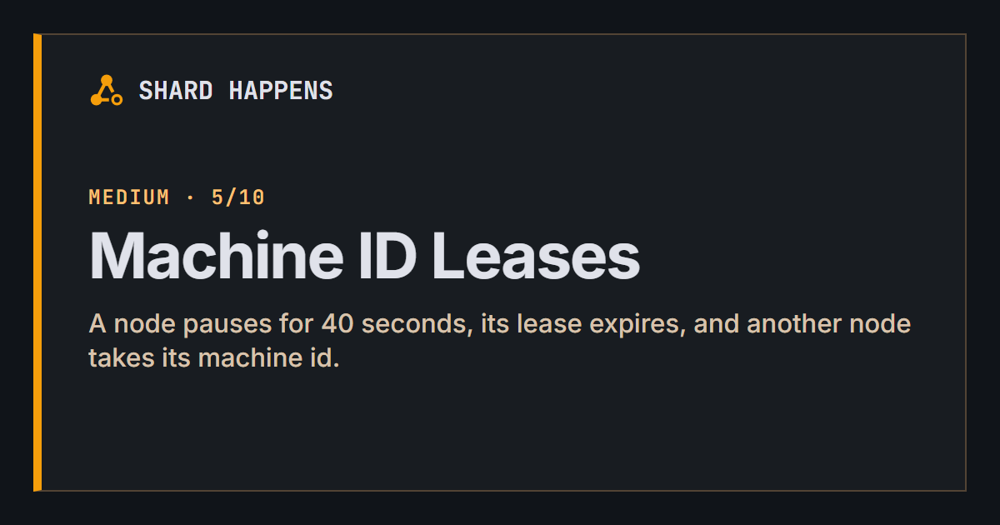

# 24. Machine ID Leases

> A node pauses for 40 seconds, its lease expires, and another node takes its machine id.

The Ownership Challenge (worker ids in Snowflake-style generators). Machine ids claimed from a coordinator with a lease, what a node does when it cannot renew, and what stops a paused node and its successor from issuing the same id when their clocks disagree.

| Level | Score | Data modelling | Scale | Consistency | Real-time | Algorithmic depth |
|---|---|---|---|---|---|---|
| Medium | 5/10 | 1/5 | 1/5 | 4/5 | 2/5 | 3/5 |

The introduction, the difficulty breakdown, the problem framing and the questions are open to everyone. The rest of the page needs premium access.

**[Read it on shardhappens.dev](https://shardhappens.dev/problems/machine-id-leases/)**

[All problems](../README.md)
