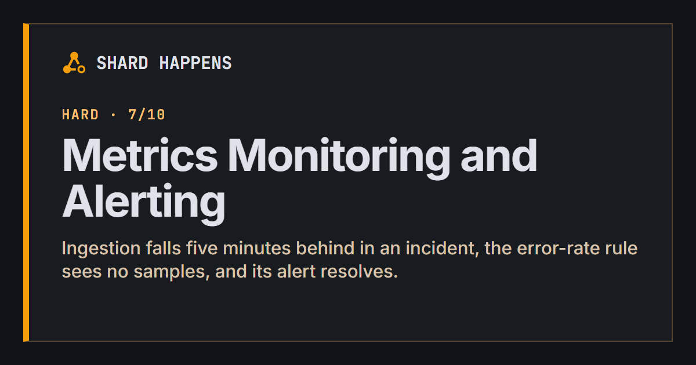

# 26. Metrics Monitoring and Alerting

> Ingestion falls five minutes behind in an incident, the error-rate rule sees no samples, and its alert resolves.

The Time Series Challenge (Prometheus with Alertmanager, Datadog, Google's Monarch). Tests what a time series costs to keep, and whether alerts stay correct when the monitoring pipeline itself is late.

| Level | Score | Data modelling | Scale | Consistency | Real-time | Algorithmic depth |
|---|---|---|---|---|---|---|
| Hard | 7/10 | 3/5 | 5/5 | 3/5 | 3/5 | 4/5 |

The introduction, the difficulty breakdown, the problem framing and the questions are open to everyone. The rest of the page needs premium access.

**[Read it on shardhappens.dev](https://shardhappens.dev/problems/metrics-monitoring-alerting/)**

[All problems](../README.md)
