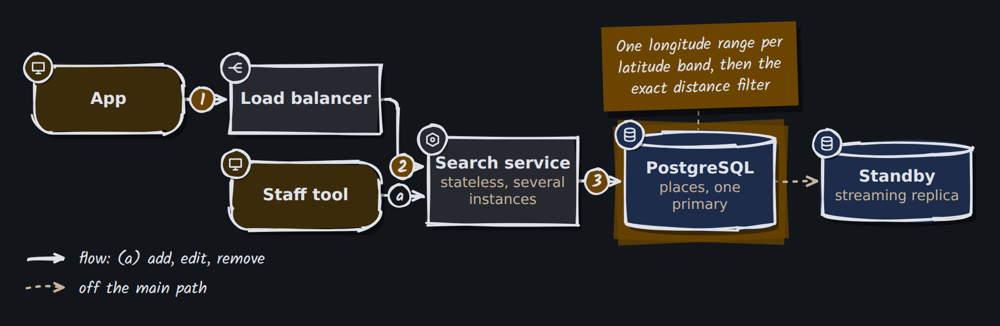

# 33. Nearby Places Search

> A 500 m search box drawn in fixed degrees reaches only 250 m east and west at 60° north.

The Geometry Challenge (store locators, "coffee near me" in a city guide). An easy problem on one relational database: an index that answers a radius query, the distance arithmetic behind it, and what changes near the poles and the 180th meridian.

| Level | Score | Data modelling | Scale | Consistency | Real-time | Algorithmic depth |
|---|---|---|---|---|---|---|
| Easy | 3/10 | 2/5 | 2/5 | 1/5 | 1/5 | 3/5 |

## What the interviewer looks for

| Green flags | Red flags |
|---|---|
| Explains why two single-column indexes each return a strip around the Earth | Indexes latitude and longitude separately and calls it a spatial index |
| Names which index entries one search reads | Says "use a geospatial index" without saying which rows it touches |
| Computes the longitude range from the latitude | Uses a box of fixed degrees |
| Shows that the bands read cover the whole circle wherever the user stands | Reads only the user's own cell |
| States rules for a pole or the 180th meridian | Assumes the box never wraps |
| Stops reading once the nearest N are certain, and says why | Reads every place within 5 km and sorts them |
| Decides against a cache from the arithmetic | Adds a cache, shards or an in-memory index before doing the arithmetic |

The page is free to read in full: the questions an interviewer asks, the approaches compared, the whole design and the numbers behind it.

**[Read it on shardhappens.dev](https://shardhappens.dev/problems/nearby-places/)**

[All problems](../README.md)
