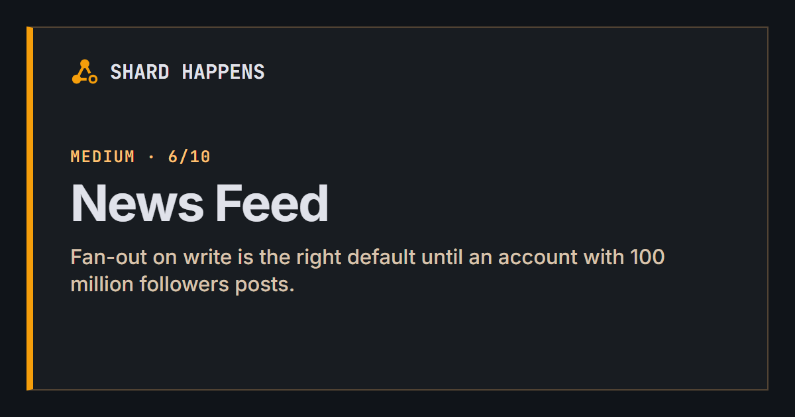

# 6. News Feed

> Fan-out on write is the right default until an account with 100 million followers posts.

The Fan-out Challenge (X home timeline, Instagram feed). Added to the set: the canonical test of precompute vs compute-on-read, and of handling extreme skew in a social graph.

| Level | Score | Data modelling | Scale | Consistency | Real-time | Algorithmic depth |
|---|---|---|---|---|---|---|
| Medium | 6/10 | 3/5 | 5/5 | 2/5 | 3/5 | 3/5 |

The introduction, the difficulty breakdown, the problem framing and the questions are open to everyone. The rest of the page needs premium access.

**[Read it on shardhappens.dev](https://shardhappens.dev/problems/news-feed/)**

[All problems](../README.md)
