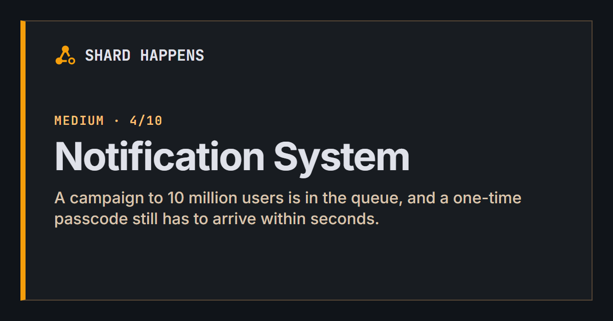

# 11. Notification System

> A campaign to 10 million users is in the queue, and a one-time passcode still has to arrive within seconds.

The Reliability Challenge (order updates, one-time passcodes, marketing campaigns across push, SMS and email). Tests asynchronous design, retries and dealing with third parties that fail.

| Level | Score | Data modelling | Scale | Consistency | Real-time | Algorithmic depth |
|---|---|---|---|---|---|---|
| Medium | 4/10 | 2/5 | 3/5 | 3/5 | 2/5 | 2/5 |

The introduction, the difficulty breakdown, the problem framing and the questions are open to everyone. The rest of the page needs a free account.

**[Read it on shardhappens.dev](https://shardhappens.dev/problems/notification-system/)**

[All problems](../README.md)
