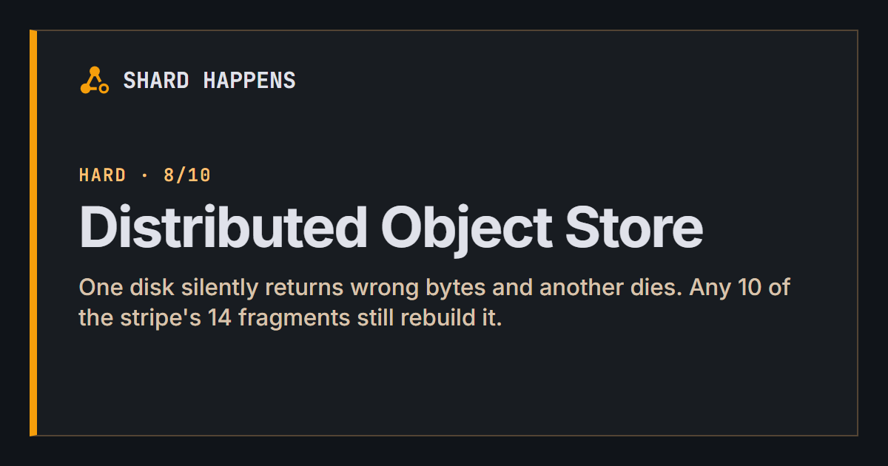

# 70. Distributed Object Store

> One disk silently returns wrong bytes and another dies. Any 10 of the stripe's 14 fragments still rebuild it.

The Durability Challenge (Amazon S3). Keep every acknowledged object readable for years through disk, node and rack failures and silent corruption, at well under three copies, with one record per stripe deciding which fragments exist.

| Level | Score | Data modelling | Scale | Consistency | Real-time | Algorithmic depth |
|---|---|---|---|---|---|---|
| Hard | 8/10 | 3/5 | 4/5 | 5/5 | 2/5 | 4/5 |

The introduction, the difficulty breakdown, the problem framing and the questions are open to everyone. The rest of the page needs premium access.

**[Read it on shardhappens.dev](https://shardhappens.dev/problems/object-store/)**

[All problems](../README.md)
