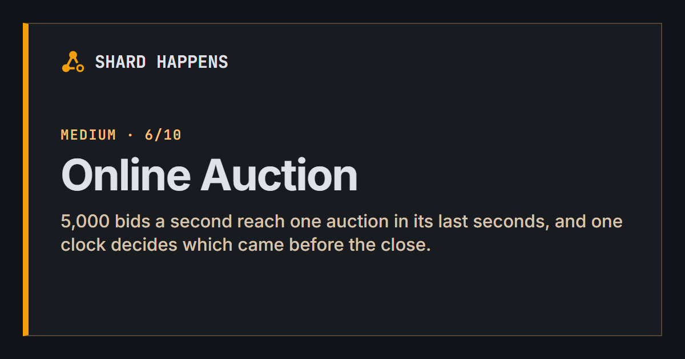

# 47. Online Auction

> 5,000 bids a second reach one auction in its last seconds, and one clock decides which came before the close.

The Deadline Challenge (eBay auctions). Many bidders bid on one item in its last seconds, every bid is decided before or after the close by one clock, and everyone agrees on one winner.

| Level | Score | Data modelling | Scale | Consistency | Real-time | Algorithmic depth |
|---|---|---|---|---|---|---|
| Medium | 6/10 | 2/5 | 4/5 | 4/5 | 4/5 | 2/5 |

The introduction, the difficulty breakdown, the problem framing and the questions are open to everyone. The rest of the page needs premium access.

**[Read it on shardhappens.dev](https://shardhappens.dev/problems/online-auction/)**

[All problems](../README.md)
