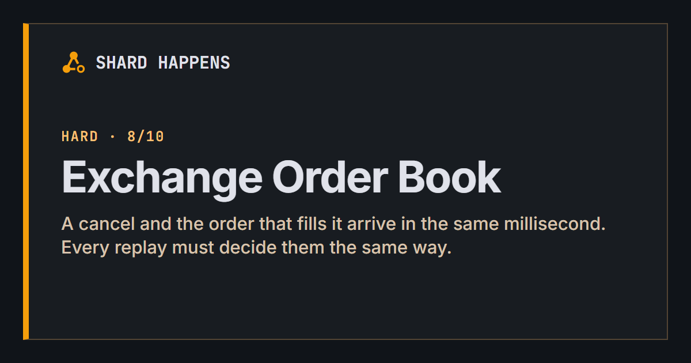

# 51. Exchange Order Book

> A cancel and the order that fills it arrive in the same millisecond. Every replay must decide them the same way.

The Determinism Challenge (stock exchanges, crypto exchanges). Match limit orders by price then time, settle a cancel that races a fill, and come back from a crash to exactly the state the engine had.

| Level | Score | Data modelling | Scale | Consistency | Real-time | Algorithmic depth |
|---|---|---|---|---|---|---|
| Hard | 8/10 | 3/5 | 3/5 | 5/5 | 5/5 | 4/5 |

The introduction, the difficulty breakdown, the problem framing and the questions are open to everyone. The rest of the page needs premium access.

**[Read it on shardhappens.dev](https://shardhappens.dev/problems/order-book/)**

[All problems](../README.md)
