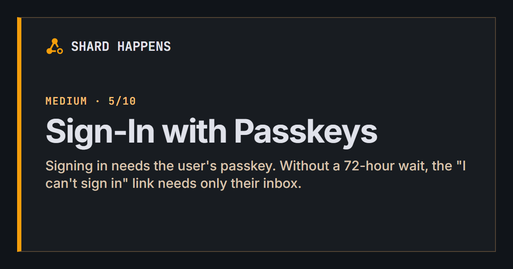

# 63. Sign-In with Passkeys

> Signing in needs the user's passkey. Without a 72-hour wait, the "I can't sign in" link needs only their inbox.

The Weakest Way In Challenge (consumer sign-in built on WebAuthn). Register, use and revoke passkeys, keep sessions revocable, and design account recovery so that it does not hand the account to anyone who controls the user's inbox.

| Level | Score | Data modelling | Scale | Consistency | Real-time | Algorithmic depth |
|---|---|---|---|---|---|---|
| Medium | 5/10 | 3/5 | 2/5 | 3/5 | 1/5 | 2/5 |

The introduction, the difficulty breakdown, the problem framing and the questions are open to everyone. The rest of the page needs premium access.

**[Read it on shardhappens.dev](https://shardhappens.dev/problems/passkey-sign-in/)**

[All problems](../README.md)
