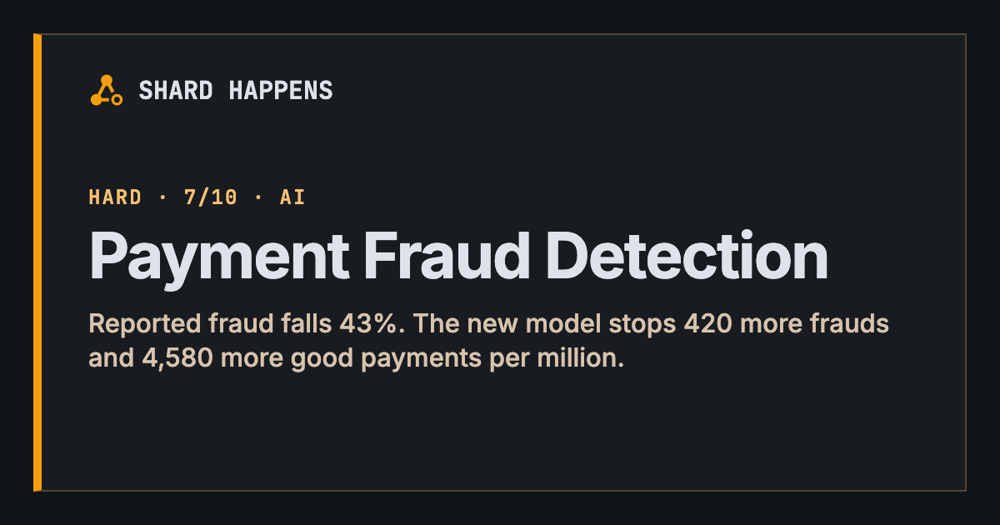

# 74. Payment Fraud Detection

> Reported fraud falls 43%. The new model stops 420 more frauds and 4,580 more good payments per million.

The Censored Outcome Challenge (Stripe Radar). AI architecture: score a payment within its deadline, choose approve, challenge or decline, and evaluate a new model when the model's own declines hide the outcomes that would judge it.

| Level | Score | Data modelling | Scale | Consistency | Real-time | Algorithmic depth |
|---|---|---|---|---|---|---|
| Hard · AI | 7/10 | 4/5 | 3/5 | 3/5 | 4/5 | 4/5 |

The introduction, the difficulty breakdown, the problem framing and the questions are open to everyone. The rest of the page needs a free account.

**[Read it on shardhappens.dev](https://shardhappens.dev/problems/payment-fraud-detection/)**

[All problems](../README.md)
