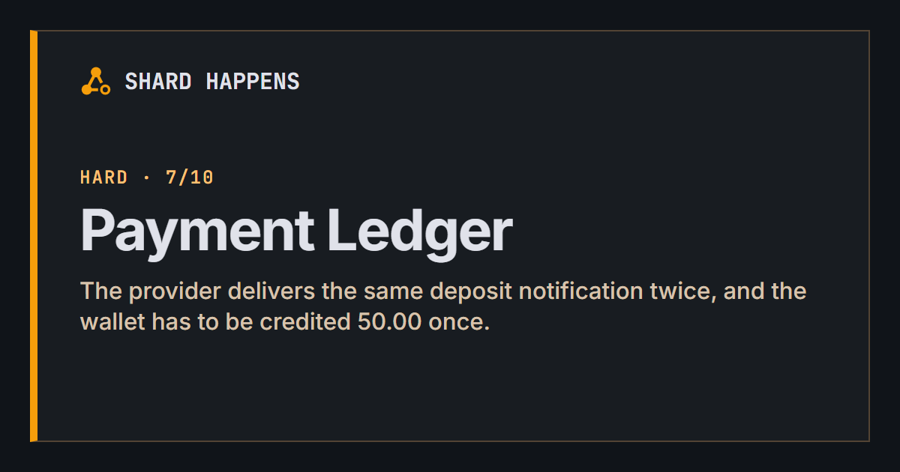

# 21. Payment Ledger

> The provider delivers the same deposit notification twice, and the wallet has to be credited 50.00 once.

The Correctness Challenge (PayPal and Venmo balances, in-app wallets). Double-entry bookkeeping, idempotent retries and webhooks, and balances that stay right under concurrent writes.

| Level | Score | Data modelling | Scale | Consistency | Real-time | Algorithmic depth |
|---|---|---|---|---|---|---|
| Hard | 7/10 | 4/5 | 3/5 | 5/5 | 2/5 | 2/5 |

The introduction, the difficulty breakdown, the problem framing and the questions are open to everyone. The rest of the page needs premium access.

**[Read it on shardhappens.dev](https://shardhappens.dev/problems/payment-ledger/)**

[All problems](../README.md)
